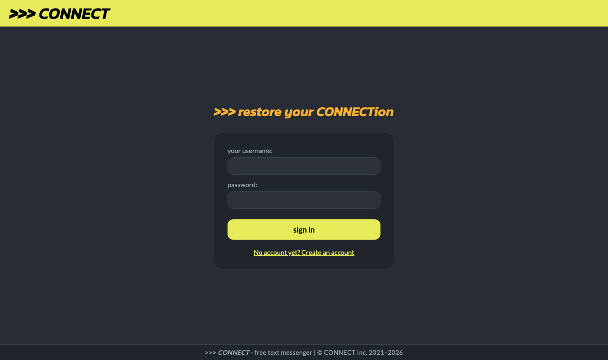
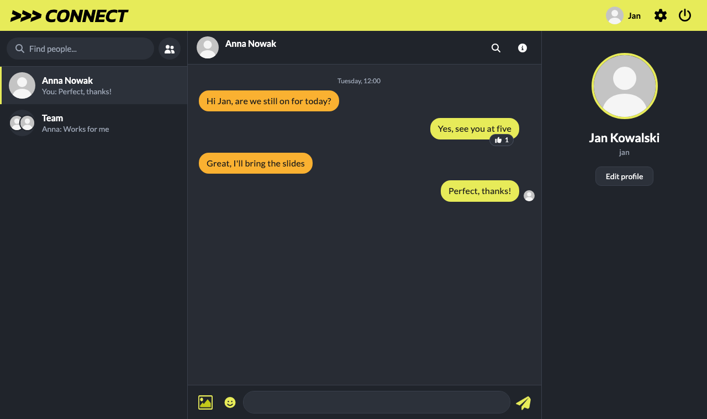
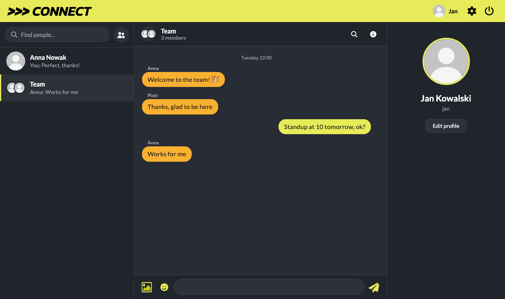
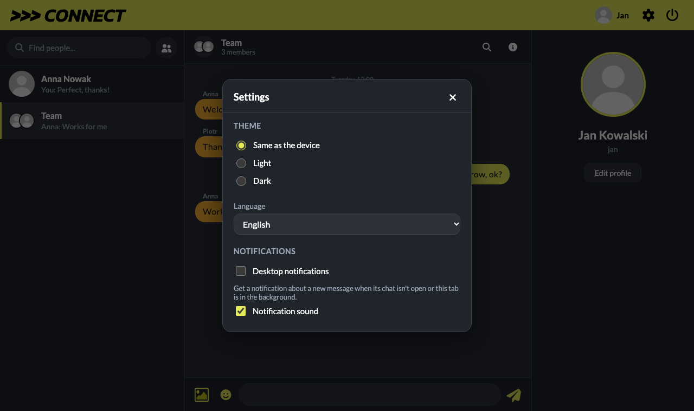

# >>> *CONNECT* messenger

A real-time chat: talk one-to-one or in groups, send photos, react to messages with emoji, edit or delete them, and see who is online, who is typing and who has read what. It comes with a dark and a light theme, several languages, desktop notifications and profile pictures. This is the server (Java, Spring Boot); the web app lives in [connect-messenger-react](https://github.com/Filip1159/connect-messenger-react).

## Screenshots

<p align="center">
  
  
</p>
<p align="center">
  
  
</p>
<p align="center">
  
</p>

```sh
# start with demo data, no database needed
SPRING_PROFILES_ACTIVE=dev sh ./gradlew bootRun
```

```sh
# run the tests
sh ./gradlew test
```

```sh
# start the server with a database in Docker
MYSQL_PASSWORD=secret JWT_SECRET=$(openssl rand -hex 32) docker compose up --build
```
